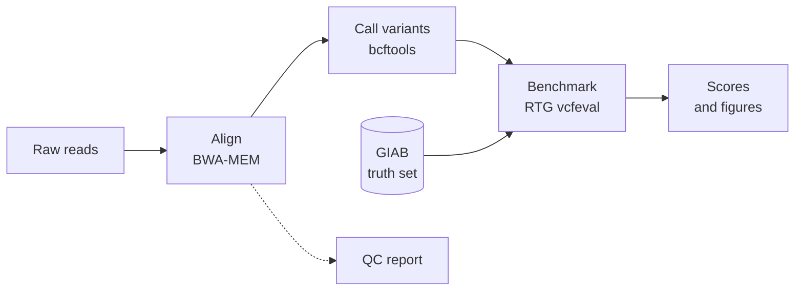
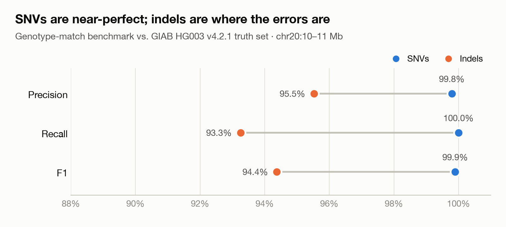
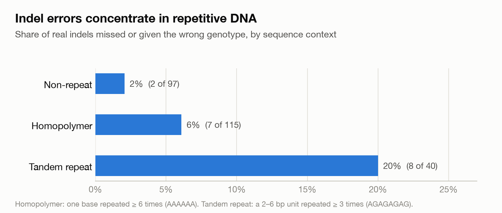

# Germline Variant Calling Pipeline

A reproducible Snakemake pipeline that takes raw Illumina sequencing reads, finds the
genetic variants (SNVs and small indels), and **scores its own accuracy against the
Genome in a Bottle (GIAB) truth set** for sample HG003.

**Headline result:** on a 1 Mb region of chr20, the pipeline finds **100% of SNVs** and
**98.4% of indels**, with **no false-positive variant alleles**. Getting the genotype
exactly right is harder for indels (94.4% F1). [Details below.](#benchmark-vs-giab-truth-set)

**Skills shown:** workflow engineering (Snakemake, conda), NGS data processing
(BWA, samtools, bcftools), benchmarking against a gold standard (RTG vcfeval),
Python data analysis and visualization, and error analysis.

## Why this project

Clinical and research labs need to know how much to trust a variant caller. GIAB
publishes "known-correct" variant calls for reference samples, so this pipeline
reports precision and recall against them instead of just producing a VCF.

## Pipeline



| Step | Tool |
|---|---|
| Alignment | BWA-MEM |
| BAM processing & QC | samtools |
| Variant calling | bcftools mpileup / call |
| Benchmarking | RTG vcfeval (the engine behind the GA4GH benchmarking standard) |
| Workflow | Snakemake |
| Environment | conda (`environment.yml`) |

## Data

All data is public. To keep run time to a few minutes on a laptop, the pipeline uses a
**1 Mb slice of chromosome 20** (`chr20:10,000,000-11,000,000`).

| Data | Source |
|---|---|
| Reference genome (GRCh38 chr20) | UCSC |
| HG003 Illumina NovaSeq reads (35×, chr20) | GIAB, via Google DeepVariant test data |
| HG003 v4.2.1 benchmark VCF + confident-region BED | GIAB |

## Quick start

**You'll need:** macOS or Linux, [conda](https://github.com/conda-forge/miniforge)
(Miniforge recommended), about 1.5 GB of free disk space while downloading, and
about 15 minutes.

```bash
# 1. Get the code
git clone https://github.com/bluisa12/variant-calling-pipeline.git
cd variant-calling-pipeline

# 2. Create and activate the environment (a few minutes)
conda env create -f environment.yml
conda activate variants

# 3. Download the test data (5-15 minutes, depending on your connection)
bash scripts/download_data.sh

# 4. Run the whole pipeline (about a minute)
snakemake --cores 4
```

Results land in `results/HG003/`, and the figures are regenerated in `docs/figures/`.

## Project layout

```
config/config.yaml              sample, region, filters and file paths
scripts/download_data.sh        fetches all public test data
scripts/summarize_benchmark.py  turns vcfeval output into precision/recall tables
scripts/make_figures.py         README figures (light + dark versions)
docs/figures/                   generated figures (committed so GitHub can show them)
workflow/Snakefile              pipeline entry point
workflow/rules/align.smk        alignment, duplicate marking, alignment QC
workflow/rules/call.smk         variant calling, normalization, filtering
workflow/rules/benchmark.smk    comparison against the GIAB truth set, figures
data/  results/                 created locally, not committed to git
```

## Results

### Alignment QC (HG003, chr20:10–11 Mb)

| Metric | Value | What it means |
|---|---|---|
| Read pairs | 134,751 (2 × 151 bp) | Input after extracting the region |
| Reads mapped | 99.8% | Almost every read found its place in the reference |
| Properly paired | 99.6% | Mates align at the expected distance and orientation |
| Mean depth | 35.7× | Each base is covered by ~36 reads on average |
| Bases covered | 99.998% | Only ~20 bp of the 1 Mb region has no reads |
| Duplicates | 11.5% | Typical for PCR-free whole-genome libraries; flagged, not removed |
| Mismatch rate | 0.45% | Sequencing errors plus real variants |
| Insert size | 419 ± 170 bp | Fragment length of the sequencing library |

Generated by `samtools flagstat`, `samtools stats`, `samtools coverage` and
`samtools markdup` in `results/HG003/qc/`.

### Variant calls

| Metric | Value | What it means |
|---|---|---|
| Variant sites passing filters | 1,903 | 22 more were labelled `LowQual` (QUAL < 20 or depth < 10) |
| SNVs / indels | 1,561 / 345 | Single-base changes vs. small insertions/deletions |
| Multi-allelic sites | 39 | Two different alternate alleles at one position (genotype 1/2) |
| Transition/transversion (Ts/Tv) | 2.17 | Real human variants give ~2.0–2.1; random errors pull it toward 0.5 |
| Heterozygous / homozygous alt | 1,379 / 524 | ~2.6 : 1, in the expected range for a human genome |

### Benchmark vs. GIAB truth set

<picture>
  <source media="(prefers-color-scheme: dark)" srcset="docs/figures/HG003_benchmark_dark.png">
  
</picture>

Passing calls are compared with the 1,694 truth variants inside GIAB's confident
regions using RTG vcfeval, in two ways:

- **Genotype match** (strict): right alleles *and* right genotype, e.g. 0/1 vs 1/1.
- **Allele match**: right alleles; genotype ignored.

| Match | Type | Truth variants | TP | FP | FN | Precision | Recall | F1 |
|---|---|---|---|---|---|---|---|---|
| genotype | SNV | 1,442 | 1,442 | 3 | 0 | 99.8% | 100.0% | 99.9% |
| genotype | INDEL | 252 | 235 | 11 | 17 | 95.5% | 93.3% | 94.4% |
| genotype | **ALL** | 1,694 | 1,677 | 14 | 17 | **99.2%** | **99.0%** | **99.1%** |
| allele | SNV | 1,442 | 1,442 | 0 | 0 | 100.0% | 100.0% | 100.0% |
| allele | INDEL | 252 | 248 | 0 | 4 | 100.0% | 98.4% | 99.2% |
| allele | **ALL** | 1,694 | 1,690 | 0 | 4 | **100.0%** | **99.8%** | **99.9%** |

*TP = true positive, FP = false positive, FN = false negative. Precision: of what we
called, how much is real. Recall: of what is real, how much we found.*

**Reading the table:**
- **SNVs are essentially solved** at this depth: every one was found, and only 3 had
  the wrong genotype.
- **Indels are where the errors are.** Every error that remains after ignoring
  genotype is an indel, and most indel errors are genotype mistakes: the caller
  found the variant but misjudged one copy vs. two.
- **Repetitive DNA is the culprit.** Of the 17 real indels that were missed or
  given the wrong genotype, 15 sit in repeats. Indels inside tandem repeats (like
  `AGAGAGAG`) are called wrong **about 10× as often** as indels outside repeats:
  20% vs. 2%. Short reads struggle to show exactly how
  many repeat units are present.

<picture>
  <source media="(prefers-color-scheme: dark)" srcset="docs/figures/HG003_indel_context_dark.png">
  
</picture>

## What I learned

**Benchmarks can penalize formatting choices, not just real mistakes.** My first
version split multi-allelic sites into one row per allele, which is a common
normalization step. The benchmark then scored the two halves of a `1/2` site as two
separate wrong calls. Keeping those sites as one row changed the results:

| | Split rows | Kept together |
|---|---|---|
| Allele-level false positives | 19 | **0** |
| Indel F1 (genotype match) | 91.7% | **94.4%** |

None of the calls changed. Only their representation did. Before trusting a
benchmark number, check what the errors actually are.

## Limitations and next steps

This is a small, deliberately laptop-sized benchmark, so the numbers should be read
with that in mind:

- **Small region, one sample.** 1 Mb of chr20 for one GIAB sample: 1,694 truth
  variants, of which only 252 are indels. Indel percentages in particular carry real
  uncertainty: one more or one fewer error moves indel recall by about 0.4 points.
- **Slightly easier than a real run.** The reads were taken from an existing
  whole-chromosome alignment by region. Reads that belong here but were originally
  placed elsewhere in the genome are missing, which removes some of the mapping
  ambiguity a true whole-genome run would face.
- **Only GIAB's confident regions are scored.** The hardest parts of the genome
  (segmental duplications, large repeats) are excluded from the benchmark by design.
- **One basic caller.** bcftools is a fast, classical caller and a useful baseline.

Natural extensions:

1. **Compare callers.** Run DeepVariant or GATK HaplotypeCaller on the same reads and
   benchmark all three side by side. Indels in repeats are where they should differ most.
2. **Scale up.** Run the whole of chr20 to tighten the indel numbers.
3. **Tune the filters.** vcfeval already writes ROC data (`-f QUAL`), so plot how
   precision and recall trade off as the quality threshold changes.

## License

[MIT](LICENSE)
